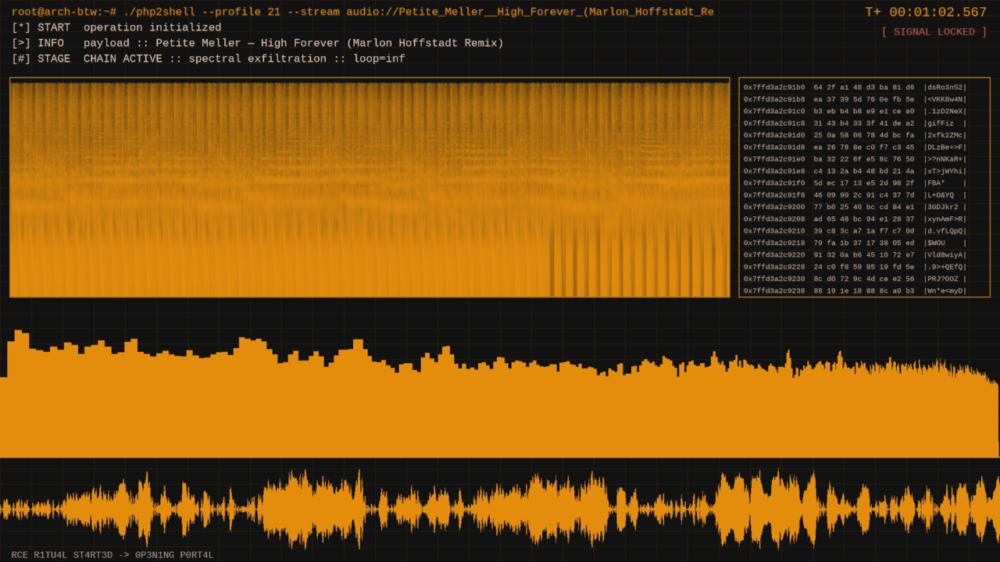

# Hacker Viz

A "hacker terminal" audio visualizer for [Omarchy](https://omarchy.org): a
scrolling spectrogram, a live hex dump, frequency bars and a waveform under a
fake `php2shell` session header. It's drawn in your **Omarchy theme colors** and
**fades smoothly to the new palette when you switch themes**, without
interrupting playback.



Play any YouTube/SoundCloud URL, local file, or YouTube search. Tracks loop
forever and are cached after the first play, so relaunching is near-instant
(~0.4 s).

## Install

```bash
omarchy plugin add https://github.com/bayrock/omarchy-hacker-viz.git --enable
```

Like every Omarchy plugin, it runs unsandboxed inside `omarchy-shell`. Read
`Panel.qml` and `bin/hacker-viz` before enabling it. They're short.

### Requirements

`mpv`, `yt-dlp`, `socat`, `jq` and the JetBrainsMono Nerd Font. All are part
of Omarchy's base install, so there's nothing extra to install.

## Use

```bash
# toggle with the default track
omarchy-shell shell toggle bayrock.hacker-viz '{}'

# play something specific (URL, file, or search terms) with an optional header label
omarchy-shell shell summon bayrock.hacker-viz '{"src":"daft punk around the world"}'
omarchy-shell shell summon bayrock.hacker-viz '{"src":"~/Music/track.flac","label":"My Track"}'
omarchy-shell shell call bayrock.hacker-viz play 'https://www.youtube.com/watch?v=...'

# on/off, e.g. for a menu checkmark
omarchy-shell shell call bayrock.hacker-viz status ''
```

In the window: <kbd>f</kbd> fullscreen, <kbd>space</kbd> pause, <kbd>q</kbd> quit.

### Keybinding

Add to `~/.config/hypr/bindings.lua`:

```lua
o.bind("SUPER + CTRL + SHIFT + V", "Toggle hacker visualizer", "omarchy-shell shell toggle bayrock.hacker-viz '{}'")
```

### Omarchy menu entry

Add to `~/.config/omarchy/extensions/omarchy-menu.jsonc` (Trigger → Toggle):

```jsonc
"trigger.toggle.hacker-viz": {"icon":"󰐰","label":"Hacker Visualizer","action":"omarchy-shell shell toggle bayrock.hacker-viz '{}'","checked":"[[ $(omarchy-shell shell call bayrock.hacker-viz status '') == on ]]"},
```

## Options

- **Default track:** change the `SRC=` and `LABEL=` defaults near the top of
  `bin/hacker-viz` (or always pass `src`).
- **Original green look:** set `HACKER_VIZ_THEME=green` in the shell's environment.
- **Cache:** audio is kept in `~/.cache/hacker-viz/`. Clear it with
  `rm -rf ~/.cache/hacker-viz`.
- **Standalone:** `bin/hacker-viz [src] [label]` also works without the plugin.
  Running it again closes it, and `bin/hacker-viz retheme` recolors running
  instances.

## How it works

- `bin/hacker-viz` runs mpv with a `--lavfi-complex` graph (`showspectrum`,
  `showfreqs`, `showwaves`, `drawtext`, ...). The graph draws a color-neutral
  *mask*: red = accent layers, green = text, blue = alert. One
  `colorchannelmixer` in mpv's `--vf` chain maps it to the theme:
  `out = bg + R·(accent−bg) + G·(fg−bg) + B·(alert−bg)`. Colors come from
  `~/.local/state/omarchy/current/theme/colors.toml`.
- On a theme change, the plugin (watching `qs.Commons` `Color`) runs
  `hacker-viz retheme`. That steps the mixer coefficients to the new palette
  over ~0.8 s via `vf-command` on mpv's IPC socket. The audio graph is never
  rebuilt, so playback isn't interrupted.
- Resolving a YouTube URL costs ~2 s per launch, so the first play streams while
  a background `yt-dlp` saves the audio. Later launches play the cached file
  with OpenGL output, which skips the slower Vulkan device setup.

## License

[MIT](LICENSE) © 2026 shojo.me. The default track is streamed from YouTube
and isn't distributed with this plugin.
